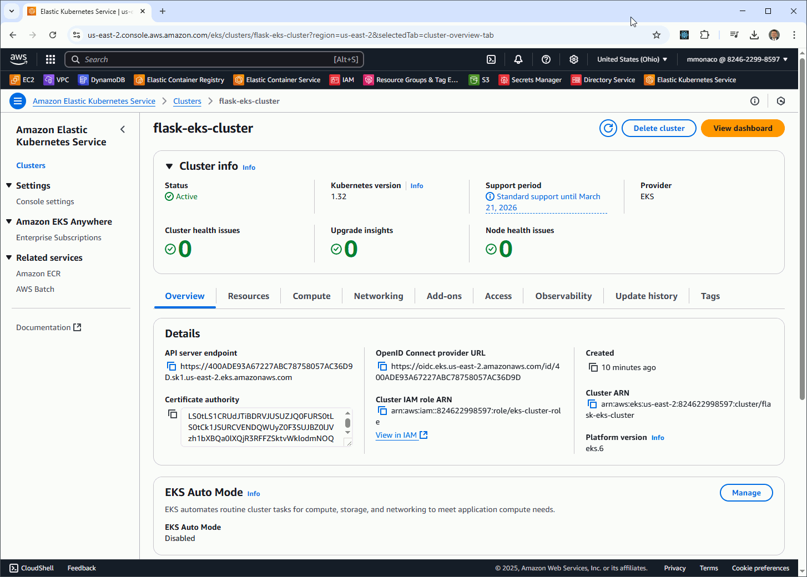

# Kubernetes on AWS: Amazon EKS with NGINX Ingress, ECR and DynamoDB

Video 1 of the [Kubernetes in the Cloud](https://github.com/mamonaco1973/cloud-k8s-intro/blob/main/README.md)
series. The candidate microservice from
[AWS Auto Scaling](https://github.com/mamonaco1973/aws-flask-asg) and
[Simple AWS Containers](https://github.com/mamonaco1973/aws-flask-container)
runs here on **Amazon EKS**, next to three browser games (Tetris, Frogger and
Breakout). Images live in **ECR**, the Flask pods store candidates in
**DynamoDB** through IAM Roles for Service Accounts, and an **NGINX ingress
controller** behind one load balancer routes to everything. Terraform builds
the infrastructure and the add-ons; `kubectl` deploys the apps.



| Piece | Where | Role |
|---|---|---|
| **VPC** | `10.0.0.0/24`, us-east-2 | two public and two private `/26` subnets in `us-east-2a` and `us-east-2b`; a NAT gateway for the private subnets |
| **flask-eks-cluster** | EKS | managed control plane; an OIDC provider for IRSA |
| **flask-nodes** | node group, private subnets | `t3.medium`, 1 to 4 nodes (scaled by the cluster autoscaler); runs `flask-app` |
| **game-nodes** | node group, private subnets | `t3.medium`, 1 node; runs the games in the `games` namespace |
| **Add-ons** | Helm, `kube-system` / `ingress-nginx` | AWS Load Balancer Controller, cluster autoscaler (chart 9.29.1) and the NGINX ingress controller |
| **nginx-ingress-lb** | public subnets | internet-facing load balancer for the NGINX controller, preserving client IPs |
| **flask-app** | Deployment | 2 replicas, scaled 2 to 5 by an HPA at 60% CPU; `/gtg` liveness and readiness probes; service account `dynamodb-access-sa` |
| **tetris**, **frogger**, **breakout** | Deployments, `games` | one replica each |
| **Candidates** | DynamoDB | keyed on `CandidateName`; TTL on `TimeToExist` |
| **flask-app**, **games** | ECR | the images, tagged `flask-app-rc1` and `tetris-rc1` / `frogger-rc1` / `breakout-rc1` |

## Architecture

<picture>
  <source media="(prefers-color-scheme: dark)" srcset="architecture-dark.svg">
  
</picture>

Regenerate with `python3 make_diagram.py`.

- **`01-ecr/`**: the VPC, subnets and NAT gateway, and both ECR
  repositories.
- **`02-docker/`**: the Flask app and the three games, each with its
  `Dockerfile`, plus the `test_candidates.py` smoke test.
- **`03-eks/`**: the cluster and node groups (`eks.tf`), the DynamoDB table,
  the IAM roles for the add-ons and for `dynamodb-access-sa`, the Helm
  releases, and the manifest templates in `yaml/`.
- **`stress.yaml`**: a CPU load generator for the autoscaling test.

## Endpoints

| Path | Returns |
|---|---|
| `GET /flask-app/api/gtg` | 200; with `?details=true`, connection details |
| `GET /flask-app/api/<name>` | the candidate, or 404 |
| `POST /flask-app/api/<name>` | `{"CandidateName": <name>}`, or 500 |
| `GET /flask-app/api/candidates` | every candidate, or 404 |
| `GET /games/tetris` | Tetris |
| `GET /games/frogger` | Frogger |
| `GET /games/breakout` | Breakout |

The games are [Tetris](https://gist.github.com/straker/3c98304f8a6a9174efd8292800891ea1),
[Frogger](https://gist.github.com/straker/82a4368849cbd441b05bd6a044f2b2d3)
and [Breakout](https://gist.github.com/straker/98a2aed6a7686d26c04810f08bfaf66b)
by Steven Lambert, served by NGINX.

| Tetris | Frogger | Breakout |
|---|---|---|
|  |  |  |

## Prerequisites

* [An AWS Account](https://aws.amazon.com/console/)
* [Install AWS CLI](https://docs.aws.amazon.com/cli/latest/userguide/getting-started-install.html)
* [Install Terraform](https://developer.hashicorp.com/terraform/install)
* [Install Docker](https://docs.docker.com/engine/install/)
* [Install kubectl](https://kubernetes.io/docs/tasks/tools/)

If this is your first time watching our content, we recommend starting with
this video: [AWS + Terraform: Easy Setup](https://youtu.be/BCMQo0CB9wk).

## Deploy

```bash
git clone https://github.com/mamonaco1973/aws-k8s.git
cd aws-k8s
./apply.sh
```

`apply.sh`:

1. Applies **`01-ecr`** (network and repositories).
2. Builds the Flask image and the three game images and pushes them to ECR.
3. Applies **`03-eks`**: the cluster, both node groups, the table, the roles
   and the three Helm releases.
4. Points `kubectl` at the cluster and applies `flask-app.yaml` and
   `games.yaml`, rendered from their templates with your account ID.

It ends by running `validate.sh`, which waits for the ingress to get a load
balancer hostname and for `/flask-app/api/gtg` to answer, then runs the
smoke test:

```
NOTE: URL for EKS Solution is http://nginx-ingress-lb-<id>.elb.us-east-2.amazonaws.com/flask-app/api/gtg?details=true
✓ good to go passed
✓ insert passed
✓ verification passed
✓ candidate list passed
```

## Try it

1. Open `http://<load balancer hostname>/games/tetris` (or `frogger`,
   `breakout`) in a browser, and call the Flask API with `curl` or Postman.
2. Check the workloads:

   ```bash
   kubectl get pods,deployments,ingress
   kubectl get pods,deployments,ingress -n games
   kubectl get nodes
   ```

3. Test autoscaling. `stress.yaml` runs 4 replicas of `vish/stress`, each
   asking for 2 CPUs, on the Flask node group:

   ```bash
   kubectl apply -f stress.yaml
   # wait about 5 minutes
   kubectl get nodes          # the flask-nodes group grows, up to 4 nodes
   kubectl delete -f stress.yaml
   # wait about 5 minutes
   kubectl get nodes          # and shrinks back
   ```

## Teardown

```bash
./destroy.sh
```

`destroy.sh` deletes the stress test and both manifests first, so the
ingress's load balancer goes away before Terraform destroys the NGINX
release and then the rest of `03-eks`, and finally `01-ecr`.

## Is EKS PaaS or IaaS?

Both, in layers. You never install or run the Kubernetes control plane; AWS
operates, scales and patches it, and you describe node groups instead of
launching instances, which feels like PaaS. Underneath, node groups are EC2
Auto Scaling groups, the cluster autoscaler changes their sizes, and a
`Service` of type `LoadBalancer` becomes a real AWS load balancer. Tags on
subnets, instances and load balancers tie it all back to the cluster. EKS
sits between fully managed services such as RDS and plain EC2: control when
you want it, automation when you don't.

## Notes

- **Lab only.** The API and games are open to the internet over plain HTTP.
- Image tags are fixed (`*-rc1`) and the repositories are mutable, so a
  rebuild overwrites the same tag.
